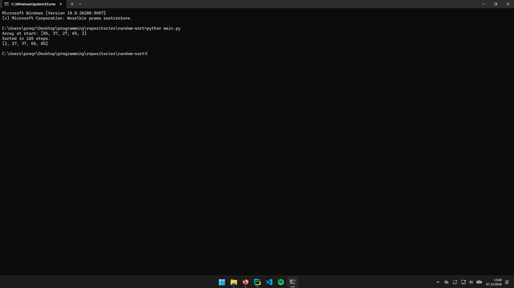

# Random Sort

Python implementation of the world's most inefficient sorting algorithm (Bogosort) using pure luck.

## How to run
python main.py

## How it works
Checks if the list is sorted. If not, shuffles it completely randomly 
and hopes for a miracle.

## Example
